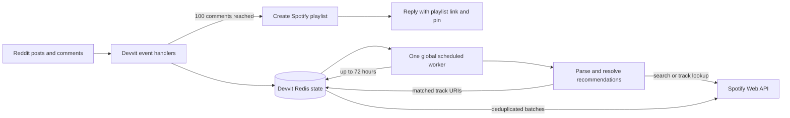

# STFL Playlist Bot

A Reddit Devvit app that turns high-engagement music discussions into Spotify playlists. It was built for communities such as [r/SongsThatFeelLikeThis](https://www.reddit.com/r/SongsThatFeelLikeThis/), where people recommend music around a mood, image, memory, or theme.

The community has grown to **116K+ members** and reached **4.5M views in its peak month**. The bot turns part of that activity into a playlist people can keep exploring.

## What it does

- Watches new Reddit posts and counts distinct comments.
- When a post reaches **100 comments**, immediately attempts to create a playlist and post a pinned Reddit reply. If Spotify is in a backoff window, it retries later.
- Resolves recognizable recommendations from text, Spotify track links, and supported YouTube links.
- Adds matched songs as comments arrive, removing duplicate Spotify tracks.
- Keeps accepting recommendations for up to **72 hours from the post’s creation**.
- Lets the original poster rename a playlist by replying to the bot’s pinned comment. A fallback name is applied after six hours if the poster does not choose one.
- Uses a periodic subreddit sweep and a scheduler watchdog to recover missed events and stalled work.

The playlist can be empty when first created; it fills as recommendations are resolved. Search results are best-effort, so an unavailable or ambiguous recommendation may be skipped.

## How the app works



The detailed flow, state model, and rate-limit protections are in [docs/architecture.md](docs/architecture.md). Operational guidance is in [docs/operations.md](docs/operations.md).

## Rate-limit handling

Spotify rate limits are not one fixed requests-per-minute number. Spotify describes its Web API limit as a rolling 30-second window; the threshold varies by app quota mode, and development-mode quota restrictions are separate. On HTTP 429, Spotify normally returns `Retry-After`; this app uses that value to pause the global queue. It also paces outbound requests, limits work per scheduler tick, records request counts in Redis, and backs off when Devvit or Spotify rejects requests.

These safeguards reduce bursts and preserve queued work, but cannot guarantee that Spotify will never throttle the app. The internal hourly allowance in log messages is the bot’s own safety budget, not Spotify’s published quota.

- [Spotify rate limits](https://developer.spotify.com/documentation/web-api/concepts/rate-limits)
- [Spotify quota modes](https://developer.spotify.com/documentation/web-api/concepts/quota-modes)

## Repository layout

- `src/server/server.ts` — Reddit event handling, recommendation parsing, Spotify calls, scheduler, retries, and playlist lifecycle.
- `src/server/index.ts` — Devvit web server entry point.
- `src/server/db.ts` — Redis counter helpers.
- `src/shared/api.ts` — shared endpoint names and response types.
- `devvit.json` — app permissions, secret setting, triggers, and scheduler task.
- `docs/` — architecture and operations notes.

This repository contains the self-contained Devvit implementation. A Cloudflare/Oracle offload was explored separately, but it is not wired into this build and is not required to run the source here.

## Requirements

- Node.js **24 or newer** (the project pins its development version in `.nvmrc`).
- npm.
- A Reddit account with access to the Devvit developer platform.
- A Spotify Developer app and a Spotify refresh token authorized for `playlist-modify-public`.

## Local setup

```bash
npm ci
npx devvit login
npm run playtest
```

The playtest uses the development subreddit configured in `devvit.json`. Do not use the production subreddit for development experiments.

Store the Spotify refresh token as a Devvit secret setting. The CLI prompts for the value:

```bash
npx devvit settings set spotify-refresh-token
```

The setting is declared with `isSecret: true` in `devvit.json`. Never commit a refresh token, access token, client secret, or local `spotify-token.json` file.

## Build and publish to Reddit

```bash
npm run build
npx devvit upload
```

`upload` creates a private installable build. When the app is ready for Reddit’s review and release process, use:

```bash
npx devvit publish
```

Publishing to Reddit is separate from pushing source to GitHub. A GitHub push does not update the live Reddit app. See the [Devvit CLI guide](https://developers.reddit.com/docs/guides/tools/devvit_cli) for current command details.

## Logs and troubleshooting

```bash
npx devvit logs r/SongsThatFeelLikeThis --since=1h --verbose
```

Look for `reached 100 comments`, `Playlist ready`, `Added ... track(s)`, `Rate limited`, and `Rescanned` messages. See [docs/operations.md](docs/operations.md) for diagnosis steps.

## Privacy and terms

The bot processes Reddit post/comment content to identify music recommendations and sends search queries to Spotify. It does not ask Reddit users for Spotify credentials. The public policy documents are maintained in the [STFL Playlist Bot Policies repository](https://github.com/Adityapawar5105/stfl-playlist-bot-policies): [Privacy Policy](https://github.com/Adityapawar5105/stfl-playlist-bot-policies/blob/main/privacy.md) and [Terms](https://github.com/Adityapawar5105/stfl-playlist-bot-policies/blob/main/terms.md).

## Limitations

- A post needs at least 100 comments before it enters the playlist workflow.
- Comment handling ends 72 hours after the post was created.
- Playlist creation and song matching depend on Reddit, Spotify, network availability, and authorization scopes.
- Spotify search may return a different recording than the commenter intended.
- A playlist may remain empty if no comments yield usable tracks.
- API quotas and rate limits can delay playlist creation or song additions.

## License

This project is licensed under the BSD 3-Clause License. See [LICENSE](LICENSE).
