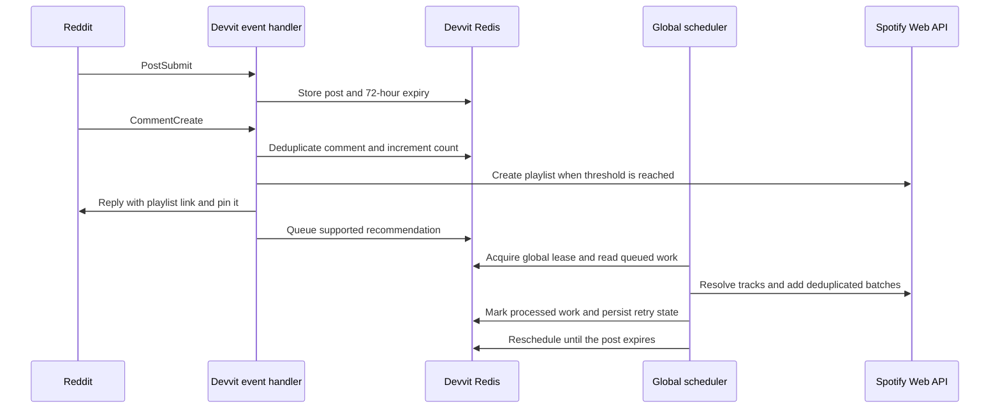

# Architecture

## Runtime path

The app is a single Devvit application. Reddit events enter `src/server/server.ts`; Devvit Redis stores post state and queues; one scheduled worker handles Spotify lookups and playlist updates.

## Event intake and qualification

1. `PostSubmit` stores the post ID, title, author, subreddit, creation time, and `activeUntil` timestamp.
2. `CommentCreate` ignores duplicate comment deliveries by recording comment IDs in Redis.
3. Before qualification, comments are counted without Spotify lookups. At 100 comments, the post enters the qualified set.
4. The app attempts playlist creation immediately. If another scheduler tick holds the lease or the global rate-limit breaker is active, it schedules a retry.
5. A periodic subreddit sweep can discover eligible posts when a comment event was missed.

The 72-hour window is measured from the original Reddit post creation time. After it expires, queued and per-post tracking data are removed.

## Recommendation processing

The recommendation parser recognizes song/artist text and supported Spotify and YouTube links. Spotify search candidates are scored before a match is selected. Resolved track URIs are cached and deduplicated per post. Work is staged and added in bounded batches; if Spotify rejects a batch because one item is invalid, the code bisects the batch so a single bad URI does not block every valid track.

The bot pins a Reddit reply containing the playlist link. If the original poster replies directly to that comment with a title, the app renames the playlist. If no title is provided, it applies a fallback title after six hours.

## Global request control

All outbound HTTP requests pass through the same pacing and budget helpers:

- A Redis lease prevents concurrent scheduler ticks from competing for the Spotify quota.
- Requests are paced globally and each tick has a bounded request budget.
- A Redis-backed breaker pauses queued work after Spotify HTTP 429, Devvit rate-limit errors, and selected server errors.
- Spotify `Retry-After` is used when present (capped at one hour); otherwise the breaker applies exponential backoff.
- Call counts and the bot’s internal hourly safety allowance are recorded in Redis for diagnostics.

The internal allowance is a conservative scheduling control. It is not Spotify’s official quota and cannot guarantee zero 429 responses.

## State keys

State is stored with Devvit Redis hashes/keys for post metadata, qualified posts, seen/processed comments, pending recommendations, lookup cache, counters, request counts, and global scheduler metadata. These are implementation details and may change as the app evolves.

## Offload experiment

A Cloudflare/Oracle processing split was explored in earlier work. The current app source does not send jobs to that service. The repository therefore keeps the integrated Devvit scheduler as the source of truth; the external worker prototype is not presented as deployable code.
